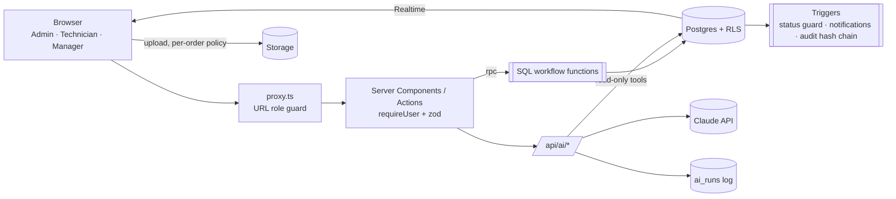

# Sejuk Ops

Service operations platform for Sejuk Sejuk Service Sdn Bhd (aircond installation, servicing and repair).
It covers the full job lifecycle, from order to technician assignment, service completion, WhatsApp notification and
manager review to the KPI dashboard, with a governed AI layer on top.

---

## What you built

Three role-based portals in one application. The role stored in the database decides which portal a user can open.

| Portal | Who | Main screens |
|---|---|---|
| Admin Console | Office admin | Overview, Orders (list + board), New order, Technicians, WhatsApp outbox, Performance (KPI dashboard), Audit log, Users & roles |
| Field App | Technicians | My jobs, job detail, five-step completion form, History (mobile-first, with a desktop layout) |
| Manager Hub | Managers | KPI dashboard, Reviews workspace, AI Supervisor flags, Audit log |

**Order lifecycle** (enforced in the database):

```
New → Assigned → In Progress → Job Done → Reviewed → Closed
                      ↑            │
                      └─ Rework ←──┘   (manager sends back with a note; technician fixes and resubmits)
Cancelled: admin only, before the work is done, reason required
```

**Brief coverage**

| Requirement | Implementation | Location |
|---|---|---|
| Module 1: Admin order submission | Customer, service, problem, quotation, technician (required), schedule, notes. The order number `SJK-YYMM-#####` is generated by a database sequence and shown as a preview. Summary after saving, and a WhatsApp message to the technician. | `/admin/orders/new` |
| Module 2: Technician service job | Start job on site, then a five-step form: work done, extra charges (final amount calculated), up to 6 photos/videos/PDFs (compressed in the browser, limit enforced by a database trigger), payment with optional receipt, review & submit. | `/tech` |
| Module 3: WhatsApp on Job Done | A database trigger writes the customer message from the brief's template, with a `wa.me` click-to-chat link, and alerts managers and accounts in-app. | `notifications` table, `/admin/notifications` |
| Bonus: KPI dashboard | Jobs completed, total amount and reschedules per technician; leaderboard; daily throughput, service mix, branch and workload charts; ranges: this week, last week, this month, last 30 days, last 8 weeks. | `/manager` |
| AI Query Window | Floating "Sejuk Ops AI" assistant for admins and managers (see [How AI was integrated](#how-ai-was-integrated)). | every admin / manager page |
| Advanced: Workflow Supervisor | 7 deterministic rules plus an AI reviewer on every completed job. | `/manager/flags` |
| Advanced: Document Understanding | Create an order from a PDF or photo of a quotation or job sheet; read the amount from a payment receipt. | New order form, technician payment step |
| Advanced: Operational Insight | Weekly AI briefing based on statistics computed in SQL. | `/manager` |

**Beyond the brief**
- **Manager Reviews workspace:**
  - tabs for Awaiting review, Ready to close (bulk close for fully paid jobs), Sent back, and Decision history;
  - Decision history is read from the audit trail, with search, filters and CSV export.
- **Notification centre** (`/notifications`) with all/unread views, paging and mark-all-read; the bell updates live.
- **Order cancellation** with reasons; the technician and the customer are notified.
- **Two-factor authentication** (Google / Microsoft Authenticator) that users enable themselves; admins can reset it.
- **Users & roles:**
  - admins create accounts (there is no public sign-up);
  - admins can deactivate accounts and reset passwords;
  - every change is written to an audit table.
- **Tamper-evident audit log** for orders, AI runs and user management.
- **Global order search** (Ctrl/⌘ K) that ranks results and tolerates typos.

## Tech stack

| Layer | Technology |
|---|---|
| Framework | Next.js 16.4 (App Router, Server Components, Server Actions, `src/proxy.ts`), React 19.3, TypeScript (strict) |
| UI | Tailwind CSS 4, shadcn/ui on Base UI, lucide-react, motion 14, Recharts 3, sonner, cmdk |
| Forms / validation | react-hook-form 7, zod 4 (shared between client, server actions and AI tool inputs) |
| Database | Supabase Postgres: SQL workflow functions, triggers, Row Level Security, Realtime (notification bell) |
| Files | Supabase Storage: private `job-media` bucket, per-order upload policies, short-lived signed URLs for viewing |
| Auth | Supabase Auth: email + password, TOTP two-factor, role held in `profiles` and mirrored to the JWT |
| AI | Anthropic Claude via `@anthropic-ai/sdk` 1.4: model `claude-opus-5-5` by default (`ANTHROPIC_MODEL` overrides it) |
| Quality | Vitest (155 tests), ESLint, `tsc --noEmit`, GitHub Actions CI (typecheck, lint, test, build), `npm run security:check` |
| Hosting | Vercel (app), Supabase (database, auth, storage) |

## Architecture decisions



1. **The database is the source of truth for the workflow.**
   - **Statuses change only through `SECURITY DEFINER` functions:** `create_order`, `assign_technician`, `start_job`, `complete_job`, `review_job`, `close_job`, `reschedule_order` and `cancel_order`.
   - **Each function checks the caller's role and the allowed transition, then appends to `order_events`.**
   - **A trigger rejects any other change to `status` or the assigned technician.** The rules hold whether the request comes from the UI, the API or the public key.
2. **Role enforcement in three layers:**
   - the URL guard (`src/proxy.ts`);
   - `requireUser` / `authorizeApi` on every page, server action and API route;
   - Postgres RLS and the role checks inside the workflow functions.

   The role comes only from `profiles.role`, never from the email address, user metadata or request parameters.
   SQL role checks are written to fail closed when the role is NULL (signed out, deactivated, or second factor pending).
3. **Least privilege:**
   - Signed-in users read through RLS.
   - Writes go through the workflow functions, plus two narrow column grants: notification read status, and AI flag resolution.
   - Technicians see only their own jobs, files and profile.
   - The anonymous key has no table access.
   - The service-role key is used only for system writes (AI logs and flags) and for audited user administration.
4. **Tamper-evident audit trail:**
   - `order_events` is append-only and SHA-256 hash-chained.
   - `verify_audit_chain()` recomputes the chain and reports the first broken link.
5. **Notifications are data.**
   - Triggers write each WhatsApp message (with its `wa.me` link) and each in-app alert into `notifications`.
   - Alerts are sent on assignment, Job Done, rework, resubmission and cancellation.
   - The bell receives alerts through Realtime.
   - Moving to the WhatsApp Business API would only need a sender that reads this table.
6. **Two-factor authentication is enforced in the database.**
   - Until the second factor is entered, `mfa_satisfied()` makes the role helpers return NULL, so a password-only session gets no data even when it calls the API directly.
7. **Security is tested by attack.**
   - `npm run security:check` signs in as a technician and runs 99 escalation attempts. Every one must be blocked:
     - edited URLs;
     - forged JWTs;
     - direct database API calls;
     - storage access;
     - office roles bypassing the workflow;
     - 2FA bypasses;
     - reading other users' AI history;
     - workflow shortcuts (complete without starting, resubmit someone else's rework).
8. **Performance under RLS:**
   - Policies call the role helpers as `(select …)`, so Postgres evaluates them once per query instead of once per row.
   - The signed-in user's session context loads in a single `session_context()` call.
9. **Data integrity in the schema:**
   - `final_amount` is a generated column (`quoted_price + extra_charges`).
   - Order numbers come from a sequence.
   - The 6-file limit is a trigger.
   - Malaysia time (`Asia/Kuala_Lumpur`, weeks start on Monday) is used for all date ranges.

## Challenges / assumptions

**Challenges**
- **Keeping a role from escaping its portal.**
  - URL and page checks alone were not enough: a user holding the public key can call the database directly.
  - The fix was to enforce roles in Postgres as well.
  - The attack script found real gaps, all closed with migrations:
    - a NULL role passing an `if not (role = …)` check;
    - technicians able to read the staff directory;
    - a notification's link being rewritable.
- **Trustworthy AI answers.**
  - The model never writes SQL. It can only call fixed, read-only tools.
  - Dates such as "last week" are resolved by a tool, not guessed by the model.
  - Every answer is built from tool results and logged.
- **Workflow correctness.**
  - The technician must start a job before completing it.
  - Rework is its own status, so a sent-back job is visible to everyone.
  - Bulk close is only offered for fully paid jobs.
  - All of these are enforced in SQL, not only hidden in the UI.

**Assumptions**
- A technician "team" in the brief is modelled as one technician record (with a team code).
- "Jobs completed" counts orders that have a completion record and are in Job Done, Reviewed or Closed within the selected range. A job in Rework does not count until it is resubmitted.
- "Postpone / reschedule count" is the number of reschedule records in the range, attributed to the assigned technician.
- WhatsApp uses click-to-chat deep links, as the brief allows: a person presses Send.
- Amounts are in RM. Tax and discounts are out of scope.
- Every order must have a technician when it is created, so there is no unassigned backlog.

## How AI was integrated

**Model and SDK:**
- Claude through the official `@anthropic-ai/sdk`.
- Every model call (question, tool calls, output, tokens, latency, status) is recorded in `ai_runs` and shown in the Audit log.

**1. Sejuk Ops AI (AI Query Window): `POST /api/ai/chat`, streamed (SSE)**
- **Agent loop:** the SDK tool runner, capped at 8 iterations. Every tool input is validated with zod.
- **8 read-only data tools:**
  - `get_time_context`
  - `list_technicians`
  - `search_jobs`
  - `count_jobs`
  - `technician_performance`
  - `get_order_details`
  - `workload_analysis`
  - `list_flags`
- **Tool limits:** each tool runs a parameterised query as the signed-in user (RLS applies), returns at most 50 rows, has a 10-second timeout, and masks customer phone numbers.
- **2 control tools:**
  - `render_chart` draws a chart in the chat from numbers already returned by tools.
  - `decline_request` makes off-topic refusals explicit.
- **Acceptable-use policy (`src/lib/ai/policy.ts`), checked before any model call:**
  - It blocks prompt injection, requests to change data, requests for secrets, and over-long input.
  - It limits each user to 20 questions per 10 minutes.
  - Outcomes are logged as `blocked` or `refused`.
- **Conversations** are saved on the server (`ai_conversations` / `ai_messages`):
  - only the owner can read them (RLS);
  - only the server writes them;
  - the model context is rebuilt from the last 10 stored messages, never from the browser;
  - conversations idle for 90 days are hidden immediately and purged daily by a `pg_cron` job.
- **The UI shows** the agent's steps (each tool, its inputs, row count and time), the streamed answer, links to the orders it mentions, and charts on request.

**2. Workflow Supervisor**
- It runs in the background after a technician completes a job, and when a manager starts a re-scan.
- **7 deterministic rules:**
  - amount over quotation;
  - no evidence uploaded;
  - extra charges without remarks;
  - payment mismatch;
  - payment not collected;
  - frequent reschedules;
  - slow completion.
- **AI review:** a structured-output review (zod schema) compares the problem, the work done, the charges and the evidence.
- Results are stored in `ai_flags` with severity, explanation and recommended action.

**3. Document Understanding: `POST /api/ai/extract` (admin only)**
- **Order import:**
  - accepts a PDF or image;
  - the file type is checked from its bytes;
  - structured extraction returns fields with a confidence for each;
  - the results pre-fill the new-order form, and the admin confirms before saving.
- **Receipts:** the technician's receipt photo is read for the amount, and the form warns if it differs from what was entered.

**4. Operational Insight: `/api/ai/insights`**
- SQL computes the statistics (week-on-week comparison, workload z-scores, flags, backlog). Claude only writes the narrative.
- The briefing is cached for 2 hours.
- Without the AI, a rule-based summary is shown instead.

## What limitations exist in your implementation?

- **WhatsApp is click-to-chat.** A person must press Send. Automatic delivery needs the WhatsApp Business API and Meta-approved templates. The `notifications` table is ready to act as its outbox.
- **No offline mode for technicians.** The completion form saves a local draft, but uploads need a connection.
- **The AI assistant can only answer what its 8 tools expose.**
  - Broader analytics questions are declined rather than guessed.
  - Results are capped at 50 rows per tool call.
  - Matching technician, service and branch names is fuzzy, not semantic.
- **Supervisor AI review is advisory.**
  - The rules always run.
  - A manual re-scan sends at most 10 recent jobs to the AI, to bound cost.
- **Document extraction quality depends on the input**, so an admin always confirms the fields.
- **Without `ANTHROPIC_API_KEY`:** chat and extraction are unavailable. The supervisor falls back to its rules, and the briefing to the rule-based summary.
- **Testing:**
  - Automated tests are unit tests (155) plus the security attack script.
  - There are no browser end-to-end tests in CI.
  - The security script needs a running app and database, so it is not part of CI.
- **Demo data:**
  - The seed script resets operational data on every run.
  - Seeded job photos are placeholder images.
