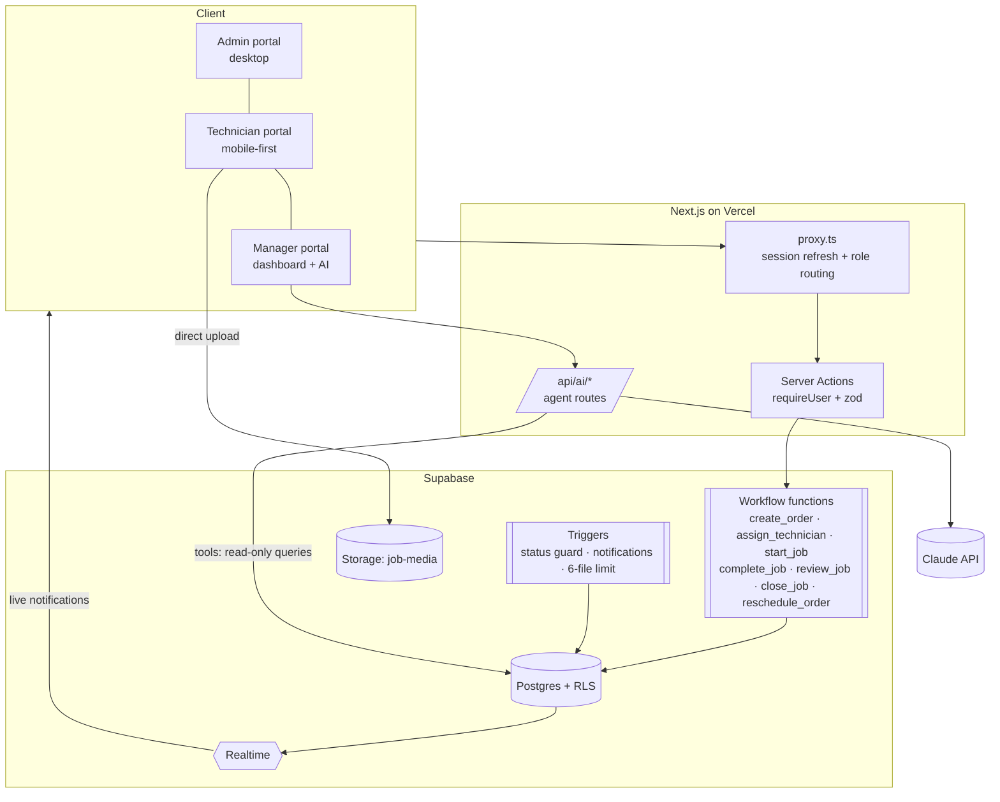

# Sejuk Ops: service operations platform with agentic AI

An internal operations system for **Sejuk Sejuk Service Sdn Bhd** (aircond installation, servicing and repair; 5 branches,
40+ field teams). It digitises the whole workflow:

**Order → Assignment → Service completion → WhatsApp notification → Manager review → KPI dashboard**

Every module in the brief is implemented, plus all three optional advanced AI challenges.

| Brief | Status | Where |
|---|---|---|
| Module 1: Admin order submission (+ order summary, WhatsApp to technician) | ✅ | `/admin/orders/new` |
| Module 2: Technician service job (mobile-first, ≤ 6 uploads, payment capture, customer feedback message) | ✅ | `/tech` |
| Module 3: WhatsApp notification on **Job Done** (DB trigger + `wa.me` deep link) | ✅ | `*_workflow.sql`, `/admin/notifications` |
| Bonus: KPI dashboard (cards, leaderboard, charts, weekly/monthly views) | ✅ | `/manager` |
| AI module: Operations Query Window | ✅ | `/manager/assistant` + floating copilot |
| Advanced: AI Workflow Supervisor | ✅ | `/manager/flags`, review workspace |
| Advanced: AI Document Understanding | ✅ | "Import from document" on the new-order form; receipt reading |
| Advanced: AI Operational Insight | ✅ | AI briefing on `/manager` |
| Real authentication + roles | ✅ | Supabase Auth, RLS, role-based portals, admin user management (`/admin/users`) |

---

## Quick start

```bash
npm install
cp .env.example .env.local          # fill in the Supabase + Anthropic keys
npx supabase link --project-ref <ref>
npx supabase db push                # applies supabase/migrations
npm run db:seed                     # sample accounts + ~8 weeks of history (resets operational data)
npm run dev
```

Open http://localhost:3000 and sign in with an email and password. The system checks the account (active, role)
and opens that role's portal: Admin → `/admin`, Manager → `/manager`, Technician → `/tech`. Sample accounts from the seed:

| Role | Account | What to try |
|---|---|---|
| Admin | `jialok.admin@sejuk.com` | Create an order (or import one from a PDF/photo), assign a technician, open the WhatsApp link |
| Technician | `benny.tech@sejuk.com` | Open a job on a phone-sized screen, start it, complete it with photos and payment, send the feedback message |
| Manager | `manager@sejuk.demo` | Dashboard, review queue, AI Supervisor flags, ask the Ops Copilot questions |

Their password is `SEED_PASSWORD` from `.env.local` (required by the seed; it is never shown in the app).
Other technician accounts: `ali@`, `john@`, `bala@`, `yusoff@sejuk.demo` (Ali and Bala feature in the AI example questions).

### Users & roles

There is no public sign-up: admins create every account in **Users & roles** (`/admin/users`).

- **New user:** name, work email, role, branch, phone and a password the admin sets (8+ characters, letters and a
  number). A technician also gets a roster entry (team code, skills), or an existing roster technician can be given a login.
- **Edit:** name, branch, phone, role, Active / Deactivated, and **Reset password**.
- **Deactivate:** the account is banned in Supabase Auth, and the database denies it at once (`current_app_role()`
  returns nothing for an inactive profile). An open session is signed out on its next request.
- **Guardrails, enforced on the server:** you can't demote or deactivate yourself, the last active admin can't be
  removed, and a technician with open jobs can't be deactivated or moved to another role until the jobs are reassigned.
- **Roles & access** tab: what each of the three fixed roles can do, mirrored from the guards, RLS and workflow functions.
- Every change is written to `user_admin_events` (append-only, never contains passwords) and shown in **Audit log → User management**.

`profiles` is the single source of truth for role and status; the `profiles_sync_claims` trigger copies both into the
JWT `app_metadata` that `src/proxy.ts` reads. Also switch off **Allow new users to sign up** in the Supabase dashboard
(Authentication → Sign In / Providers) for a hosted project; `supabase/config.toml` does this for local development.

## Tech stack

| Layer | Choice |
|---|---|
| Front end | Next.js 16 (App Router, Server Components, Server Actions), React 19, TypeScript (strict) |
| Styling / UI | Tailwind CSS v4, shadcn/ui (Base UI primitives), lucide icons, `motion` for animation, Recharts |
| Backend / DB | Supabase Postgres: SQL workflow functions, triggers, Row Level Security, Realtime |
| Files | Supabase Storage (private bucket, signed URLs, path-scoped policies) |
| Auth | Supabase Auth (email + password, no public sign-up), role + status in `profiles`, synced to the JWT `app_metadata` by trigger |
| AI | Claude (`claude-opus-5-5`) through `@anthropic-ai/sdk`: tool runner, streaming, structured outputs, PDF and vision input |
| Quality | Vitest unit tests, ESLint, `tsc --noEmit`, GitHub Actions CI |
| Deploy | Vercel |

## Architecture



### Key decisions

- **The database owns the workflow.** Status changes are only possible through `SECURITY DEFINER` functions that check the
  caller's role, validate the transition and append to `order_events`. A trigger rejects any other attempt to change
  `status` or `assigned_technician_id`, so the rules hold no matter which client is used: the UI, the API, or a curious
  user with the anon key.
  - Only an **Admin** can create orders or assign and reassign technicians.
  - Only the **assigned Technician** can start or complete a job.
  - Only a **Manager** can review (approve or send back for rework); a Manager or Admin can close.
  - All actions are **traceable** in `order_events` (actor, role, from → to, payload) and shown as a timeline.
- **Tamper-evident audit trail.** `order_events` is a SHA-256 hash chain: each event stores the previous event's hash and
  its own hash over its full content. Updates are rejected for everyone (even the service role); `verify_audit_chain()`
  recomputes the chain and reports the first broken link (edited, deleted, reordered or truncated events). The Audit log
  shows the live result ("Integrity verified · N events"), with URL-driven filters, a detail drawer and CSV export.
- **Smart global search (Ctrl/⌘ K).** `search_orders()` ranks matches across order number, customer, phone in any format
  (`0199748287`, `+60 19-974 8287`, `974 8287`), address, problem, technician, service, branch and status; multi-word
  queries must all match, and typo-tolerant trigram matching kicks in only when nothing matches exactly. It runs with the
  caller's RLS, so technicians only ever find their own jobs.
- **One app, three portals.** Each role gets its own accent colour and name (Admin Console · indigo, Field App · emerald,
  Manager Hub · azure) through `[data-portal]` theme tokens, in light and dark mode. Every page is responsive: full desktop
  layouts, stacked cards and ≥ 44 px touch targets on phones, and a native-app bottom tab bar for technicians.
- **Row Level Security everywhere.** Technicians can only see and upload to their own jobs (and storage paths); office
  staff see everything. The server uses the user-scoped client by default; the service role is reserved for system
  writes such as AI logs.
- **Notifications are data.** Triggers render the brief's WhatsApp template ("Hi {name}, Job {id} has been completed by
  Technician {name} at {time}…") into a `notifications` row with a `wa.me` deep link. They also notify the technician when
  a job is assigned and push in-app alerts to managers and accounts. Supabase Realtime delivers the alerts live (bell + toast).
  Swapping deep links for the WhatsApp Business API would only add a worker that consumes `notifications`.
- **Readable order numbers:** `SJK-YYMM-#####`, generated by a sequence in the database, so they stay unique under concurrency.
- **Final amount is a generated column** (`quoted_price + extra_charges`), so it can't drift out of sync.
- **Mobile-first technician UX:** bottom tabs, sticky action bar, a five-step completion wizard, client-side image
  compression, direct-to-storage uploads with progress, and a draft saved locally between steps.
- **Malaysia-aware:** MYR formatting, `Asia/Kuala_Lumpur` day and week bucketing (weeks start on Monday), and Malaysian phone normalisation.

## How AI is integrated

See [docs/AGENTIC_ARCHITECTURE.md](docs/AGENTIC_ARCHITECTURE.md) for the full design.

**Flow (as in the brief):** user question → agent decides which tools to call → database answers through controlled queries → Claude formats the answer.

| Capability | Implementation |
|---|---|
| **Ops Copilot** (`POST /api/ai/chat`, SSE) | `client.beta.messages.toolRunner` with Zod-validated `betaZodTool`s, streamed. The UI shows a live **agent trace**: each tool call with its inputs, row count and latency, then the streamed answer with clickable order chips. |
| **Workflow Supervisor** | `evaluateRules()` (pure, unit-tested) then a structured AI review via `messages.parse` + `zodOutputFormat`, upserted into `ai_flags`. Triggered with `after()` when a technician completes a job; managers can also re-scan. |
| **Document Understanding** (`POST /api/ai/extract`) | PDF (document block) or photo (image block) → structured `ExtractedOrderFields` with per-field confidence → pre-fills the order form, with AI-filled fields highlighted. The file type is checked from its bytes. There's a "Try a sample" PDF. |
| **Receipt reading** | The technician's payment step reads the amount from the receipt photo and warns when it doesn't match the amount entered. |
| **Operational Insight** (`/api/ai/insights`) | SQL computes this week vs the same days last week, workload z-scores, flags and backlog; Claude narrates (effort `medium`). Overload figures are forced back to the computed values. Cached in `ai_insights` for 2 hours. |

**Copilot tool catalogue** (all read-only and parameterised; results capped at 50 rows; phones masked; 10 s timeout):

| Tool | Answers questions like |
|---|---|
| `get_time_context` | resolves "today", "this week", "last week" in Malaysia time |
| `search_jobs` | "What jobs did technician Ali complete last week?" |
| `count_jobs` (group by technician / status / service / branch / day) | "How many jobs were completed today?", "Which technician completed the most jobs this week?" |
| `technician_performance` | revenue, average ticket, reschedules and rating per technician |
| `workload_analysis` | "Which technician might be overloaded this week?" (z-score against the team mean) |
| `get_order_details` | "What happened with SJK-2611-01368?" |
| `list_technicians`, `list_flags` | roster and open AI Supervisor flags |

**Supported query types:** job lists and counts filtered by technician, status, service, branch and date range; rankings and
leaderboards; revenue and average ticket; reschedules; workload and overload; single-order drill-down; open anomaly flags; and
follow-up questions in the same conversation (the last 10 turns are kept).

**Model settings:** `claude-opus-5-5` with adaptive thinking. Effort is `low` for chat and extraction and `medium` for insights.
Tool choice is left on `auto`. Server-side refusal fallback is on, the system prompt and tools are cached, and `stop_reason`
(refusal / max_tokens) is checked with typed SDK errors.

## Project structure

```
supabase/migrations/   schema · workflow engine · RLS/storage · analytics functions
scripts/               deterministic seed generator (+ tests) and seed runner
src/proxy.ts           session refresh + role-based routing
src/lib/               auth DAL, workflow rules, formatting/time, data access, AI layer
src/app/(app)/admin    Module 1 + dispatch            src/app/(app)/tech     Module 2 (mobile)
src/app/(app)/manager  KPIs, reviews, AI supervisor   src/app/api/ai         agent endpoints
src/components/        shell, shared, orders, motion, ai, ui
```

## Testing

```bash
npm run typecheck && npm run lint && npm test
```

- The SQL workflow was exercised against a real Postgres engine (PGlite): guarded transitions, role checks, the 6-file
  limit, notification triggers, KPI functions and the full seed load.
- Unit tests cover the state machine, the Malaysia-time ranges, the WhatsApp templates, the seed generator and the AI
  supervisor rules and tool schemas.

## Assumptions

- One technician "team" is modelled as one technician record. Team members can be added later as a child table.
- "Jobs completed" counts orders with a completion record in Job Done, Reviewed or Closed. A job sent back for rework
  stops counting until it is completed again.
- "Postpone / Reschedule" counts `reschedules` rows created in the period, attributed to the assigned technician.
- WhatsApp delivery uses click-to-chat deep links, as the brief suggests. Opening a link marks the notification `opened`.
- Prices are in RM. Tax and discounts are out of scope.

## Limitations

**System**
- WhatsApp is click-to-chat: a person has to press Send. Fully automatic sending needs the WhatsApp Business API
  (Meta-approved templates); the `notifications` table is ready to act as its outbox.
- No offline mode for technicians yet. The completion draft is saved locally, but uploads need connectivity.
- Seeded job photos are illustrated SVG placeholders.
- The seed script resets operational data on every run.

**AI**
- The copilot can only answer what its eight tools expose. Free-form analytics (e.g. "correlate rainfall with gas refills")
  are declined rather than guessed, and adding a capability means adding a reviewed tool.
- Results are capped at 50 rows per tool call. Very broad questions get aggregates rather than full listings.
- Name matching for technicians, services and branches is fuzzy but not semantic (it handles "Ali" but not nicknames).
- The supervisor's AI review is advisory, and AI review is capped per re-scan to bound cost. Rules always run.
- Extraction quality depends on the document. Low-confidence fields are highlighted, and an admin always confirms.
- Without `ANTHROPIC_API_KEY`, chat and extraction are unavailable. The supervisor falls back to rules and insights to a
  deterministic summary.

## Self-assessment

**Easiest:** Module 3. Once notifications were modelled as data written by a database trigger, the WhatsApp step became
a template plus a `wa.me` link, and it fires no matter which client changes the status.

**Hardest:** the Ops Copilot. Calling the model is easy; making it trustworthy took most of the effort:
- choosing a tool surface small enough to govern but broad enough to be useful;
- resolving relative dates deterministically;
- keeping RLS in force for AI reads;
- streaming a readable trace of what the agent did;
- handling refusals, truncation and missing data honestly.

**What I'd add in production:**
- WhatsApp Business API delivery with retries, read receipts and template approval.
- An offline-first technician PWA (background upload queue).
- Scheduling and dispatch optimisation by location and skills.
- Generated DB types (`supabase gen types`) and contract tests for every RPC.
- Playwright end-to-end tests against a seeded preview database on every PR.
- An evaluation set for the copilot (questions → expected SQL answers) run in CI.
- Rate limits and per-user AI budgets.
- Observability (OpenTelemetry), audit-log retention policies, and PDPA-aligned PII handling.

**How I used AI tools:** I used Claude Code as an agentic pair-programmer:
1. I designed the data model, workflow engine, contracts and conventions (`CLAUDE.md`, `src/lib/ai/contracts.ts`) myself,
   and verified the SQL against a real Postgres engine (PGlite).
2. I then had four parallel sub-agents build the Admin, Technician, Manager and AI modules against those contracts.
3. I integrated and reviewed their work, checked every RPC call against the SQL signatures, and closed the loop with
   type-checking, linting, unit tests and a production build.

The same principle runs through the product itself: agents are productive when they work inside clear contracts and
guardrails.
