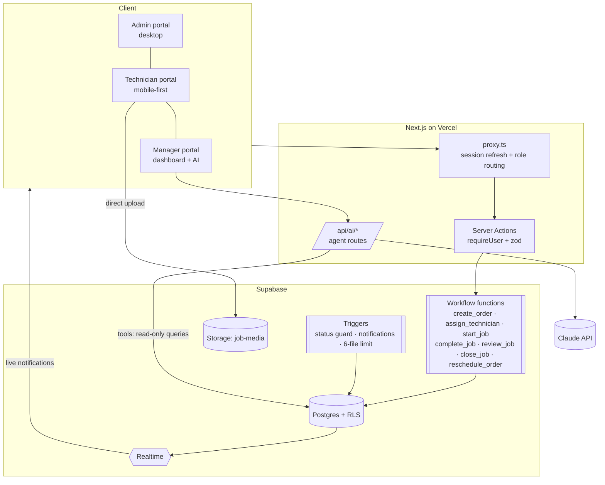

# Sejuk Ops: service operations platform with agentic AI

An internal operations system for **Sejuk Sejuk Service Sdn Bhd** (aircond installation, servicing and repair; 5 branches,
40+ field teams). It digitises the whole workflow:

**Order → Assignment → Service completion → WhatsApp notification → Manager review → KPI dashboard**

Every module in the brief is implemented, plus all three optional advanced AI challenges.

| Brief | Status | Where |
|---|---|---|
| Module 1: Admin order submission (+ order summary, WhatsApp to technician) | ✅ | `/admin/orders/new` |
| Module 2: Technician service job (mobile-first, ≤ 6 uploads, payment capture, customer feedback message) | ✅ | `/tech` |
| Module 3: WhatsApp notification on **Job Done** (DB trigger + `wa.me` deep link) | ✅ | `*_workflow.sql`, `/admin/notifications` |
| Bonus: KPI dashboard (cards, leaderboard, charts, weekly/monthly views) | ✅ | `/manager` |
| AI module: Operations Query Window | ✅ | `/manager/assistant` + floating copilot |
| Advanced: AI Workflow Supervisor | ✅ | `/manager/flags`, review workspace |
| Advanced: AI Document Understanding | ✅ | "Import from document" on the new-order form; receipt reading |
| Advanced: AI Operational Insight | ✅ | AI briefing on `/manager` |
| Real authentication + roles | ✅ | Supabase Auth, RLS, one-click demo access |

---

## Quick start

```bash
npm install
cp .env.example .env.local          # fill in the Supabase + Anthropic keys
npx supabase link --project-ref <ref>
npx supabase db push                # applies supabase/migrations
npm run db:seed                     # demo accounts + ~8 weeks of history (resets demo data)
npm run dev
```

Open http://localhost:3000 and use **Instant demo access** on the login page:

| Role | Account | What to try |
|---|---|---|
| Admin | `admin@sejuk.demo` | Create an order (or import one from a PDF/photo), assign a technician, open the WhatsApp link |
| Technician | `ali@sejuk.demo` | Open a job on a phone-sized screen, start it, complete it with photos and payment, send the feedback message |
| Manager | `manager@sejuk.demo` | Dashboard, review queue, AI Supervisor flags, ask the Ops Copilot questions |

All demo passwords are `DEMO_PASSWORD` (default `SejukDemo!2026`). To switch roles at any time, use the user menu → **Switch demo role**.
Other technician accounts: `john@`, `bala@`, `yusoff@sejuk.demo`.

## Tech stack

| Layer | Choice |
|---|---|
| Front end | Next.js 16 (App Router, Server Components, Server Actions), React 19, TypeScript (strict) |
| Styling / UI | Tailwind CSS v4, shadcn/ui (Base UI primitives), lucide icons, `motion` for animation, Recharts |
| Backend / DB | Supabase Postgres: SQL workflow functions, triggers, Row Level Security, Realtime |
| Files | Supabase Storage (private bucket, signed URLs, path-scoped policies) |
| Auth | Supabase Auth (email + password), role in `profiles` and in the JWT `app_metadata` |
| AI | Claude (`claude-opus-5-5`) through `@anthropic-ai/sdk`: tool runner, streaming, structured outputs, PDF and vision input |
| Quality | Vitest unit tests, ESLint, `tsc --noEmit`, GitHub Actions CI |
| Deploy | Vercel |

## Architecture



### Key decisions

- **The database owns the workflow.** Status changes are only possible through `SECURITY DEFINER` functions that check the
  caller's role, validate the transition and append to `order_events`. A trigger rejects any other attempt to change
  `status` or `assigned_technician_id`, so the rules hold no matter which client is used: the UI, the API, or a curious
  user with the anon key.
  - Only an **Admin** can create orders or assign and reassign technicians.
  - Only the **assigned Technician** can start or complete a job.
  - Only a **Manager** can review (approve or send back for rework); a Manager or Admin can close.
  - All actions are **traceable** in `order_events` (actor, role, from → to, payload) and shown as a timeline.
- **Row Level Security everywhere.** Technicians can only see and upload to their own jobs (and storage paths); office
  staff see everything. The server uses the user-scoped client by default; the service role is reserved for system
  writes such as AI logs.
- **Notifications are data.** Triggers render the brief's WhatsApp template ("Hi {name}, Job {id} has been completed by
  Technician {name} at {time}…") into a `notifications` row with a `wa.me` deep link. They also notify the technician when
  a job is assigned and push in-app alerts to managers and accounts. Supabase Realtime delivers the alerts live (bell + toast).
  Swapping deep links for the WhatsApp Business API would only add a worker that consumes `notifications`.
- **Readable order numbers:** `SJK-YYMM-#####`, generated by a sequence in the database, so they stay unique under concurrency.
- **Final amount is a generated column** (`quoted_price + extra_charges`), so it can't drift out of sync.
- **Mobile-first technician UX:** bottom tabs, sticky action bar, a five-step completion wizard, client-side image
  compression, direct-to-storage uploads with progress, and a draft saved locally between steps.
- **Malaysia-aware:** MYR formatting, `Asia/Kuala_Lumpur` day and week bucketing (weeks start on Monday), and Malaysian phone normalisation.

## How AI is integrated

See [docs/AGENTIC_ARCHITECTURE.md](docs/AGENTIC_ARCHITECTURE.md) for the full design.

<!-- AI-DETAILS -->

## Project structure

```
supabase/migrations/   schema · workflow engine · RLS/storage · analytics functions
scripts/               deterministic seed generator (+ tests) and seed runner
src/proxy.ts           session refresh + role-based routing
src/lib/               auth DAL, workflow rules, formatting/time, data access, AI layer
src/app/(app)/admin    Module 1 + dispatch            src/app/(app)/tech     Module 2 (mobile)
src/app/(app)/manager  KPIs, reviews, AI supervisor   src/app/api/ai         agent endpoints
src/components/        shell, shared, orders, motion, ai, ui
```

## Testing

```bash
npm run typecheck && npm run lint && npm test
```

- The SQL workflow was exercised against a real Postgres engine (PGlite): guarded transitions, role checks, the 6-file
  limit, notification triggers, KPI functions and the full seed load.
- Unit tests cover the state machine, the Malaysia-time ranges, the WhatsApp templates, the seed generator and the AI
  supervisor rules and tool schemas.

## Assumptions

- One technician "team" is modelled as one technician record. Team members can be added later as a child table.
- "Jobs completed" counts orders with a completion record in Job Done, Reviewed or Closed. A job sent back for rework
  stops counting until it is completed again.
- "Postpone / Reschedule" counts `reschedules` rows created in the period, attributed to the assigned technician.
- WhatsApp delivery uses click-to-chat deep links, as the brief suggests. Opening a link marks the notification `opened`.
- Prices are in RM. Tax and discounts are out of scope.

## Limitations

<!-- LIMITATIONS -->

## Self-assessment

<!-- SELF-ASSESSMENT -->
