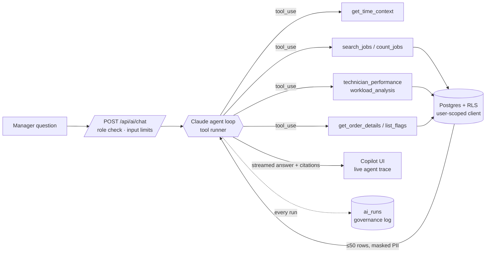

# Agentic AI architecture

Sejuk Ops treats AI as a set of **governed agents** that work *through* the system, never around it.
The model never sees the database directly. It can only call a small catalogue of tools, and each tool
is a read-only, parameterised, row-capped query that runs **with the signed-in user's permissions**.

## Four agents, one set of rules

| Agent | Trigger | What it does | Output |
|---|---|---|---|
| **Ops Copilot** | Manager asks a question | Plans which tools to call, runs them, then writes an answer from the results only | Streamed answer, cited order numbers, visible tool trace |
| **Workflow Supervisor** | Technician marks a job **Job Done** (runs in the background via `after()`), or a manual re-scan | Deterministic rules first, then an AI reviewer that compares the problem, the work done, the charges and the evidence | `ai_flags` rows with severity, explanation and recommended action |
| **Document Intelligence** | Admin uploads a quotation or job sheet (PDF or image) | Extracts structured order fields with per-field confidence | Pre-filled order form; the admin confirms before saving |
| **Operational Insight** | Manager dashboard | SQL computes the statistics (workload z-scores, trends, flags) and the model only narrates them | Cached weekly briefing in `ai_insights` |

## Guardrails

1. **No raw SQL, no unrestricted access.** The tools are a whitelist. Their inputs are validated with Zod before
   they run, and results are capped at 50 rows and trimmed to the needed columns. Customer phone numbers are masked.
2. **Least privilege.** Tools use the caller's Supabase session, so Row Level Security still applies to everything
   the AI reads. Only the governance writes (`ai_runs`, `ai_flags`, `ai_insights`) use the service role.
3. **Deterministic grounding.** Date phrases such as "last week" are resolved by `get_time_context`
   (Malaysia time, weeks start on Monday) instead of being guessed. Numbers in briefings come from SQL, not from the model.
4. **Human in the loop.** Extraction only pre-fills a form, flags only inform a manager's review, and every status
   change still goes through the workflow functions and their role checks.
5. **Observability.** Every model call is logged with its input, tool calls (name, input, rows, latency), output,
   model, token usage, latency and status. The log is visible on `/audit → AI runs`.
6. **Graceful degradation.** Without an API key the supervisor still runs its rules and the briefing falls back to
   a deterministic summary. The copilot explains that AI is not configured instead of failing silently.
7. **Scope control.** The copilot declines questions that aren't about operations data, and it says so plainly when
   the data needed to answer doesn't exist.

## Why hybrid rules + AI for the supervisor?
Rules are cheap, explainable and testable (`src/lib/ai/rules.test.ts`), so they catch the objective problems:
a final amount far above the quote, no photos, or a payment that doesn't match the final amount. The AI reviewer adds
judgement where rules can't reach, for example work done that doesn't match the reported problem, or an extra charge
with no plausible reason. Each flag records its `source` (`rule` or `ai`) so managers know what produced it.
